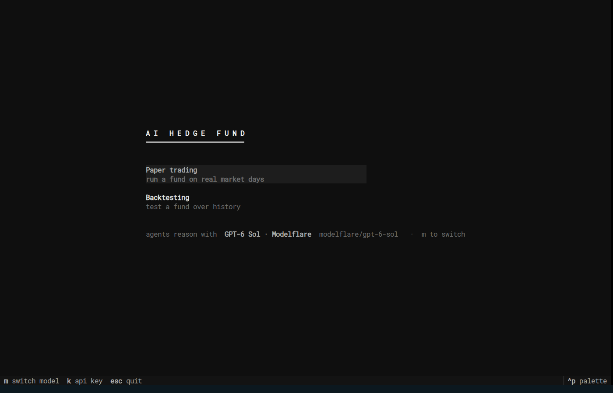
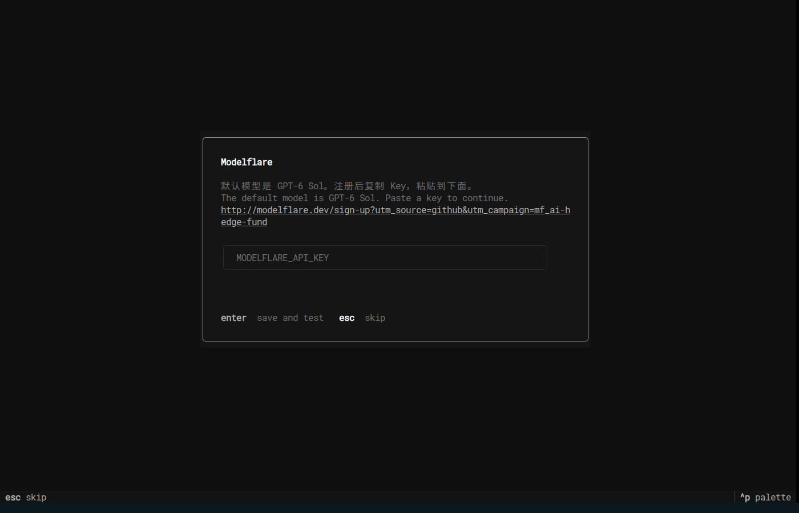
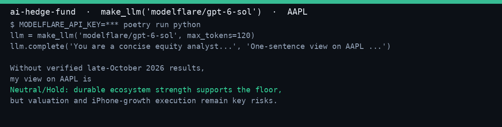

<!-- MF-START -->
<p align="center"><a href="http://modelflare.dev/sign-up?utm_source=github&utm_campaign=mf_ai-hedge-fund"></a></p>

# ai-hedge-fund · Modelflare Edition

> This is the Modelflare Edition of ai-hedge-fund: models are pre-configured, just add one Modelflare API key. [Get your key](http://modelflare.dev/sign-up?utm_source=github&utm_campaign=mf_ai-hedge-fund)

Modelflare is operated by Havenbyte LLC (USA). It supports mainstream models such as GPT, Claude, Gemini, and Grok, along with common compatible protocols, plus 40+ image and video models. API keys support ordered fallback: one API key can call multiple models, keys can be assigned backup groups, and request logs show status, latency, tokens, and actual cost.

Cache compensation is another highlight: selected OpenAI Price-First, Stable, and Premium groups guarantee daily cache hit rates of 65%, 75%, and 85% respectively. For eligible API requests that fall short of the guaranteed hit rate, the platform provides corresponding compensation.

There is also a first top-up promotion: a single top-up of US$20 unlocks the 0.015x GPT promo group, where GPT-5.6-Sol costs about ¥0.51 (input) / ¥3.01 (output) per million tokens, with no usage cap. A single top-up of US$50 unlocks the 0.03x Claude promo group.

---

Modelflare站点是由美国 Havenbyte LLC 运营，支持 GPT、Claude、Gemini、Grok 等主流模型和常用兼容协议，同时也支持 40 多种图片及视频模型。API Key 可以配置有序回退，一把 API Key 可以调用多个模型，Key 还可以设置备用分组，并且从请求日志里能看到状态、延迟、Token 和实际费用。

缓存补偿是这个站的另一个亮点：部分 OpenAI 价格优先、稳定和高级分组分别提供每日 65%、75%、85% 的缓存命中率保障，对于符合条件的api请求如果未达到缓存命中率，平台会给予对应补充。

站点目前也有首次充值解锁特惠分组的活动，单笔充值 US$20 后可解锁 0.015 倍率 GPT 特惠分组，解锁后 GPT-5.6-Sol 的价格大约是 ¥0.51（输入）/ ¥3.01（输出）/每百万 Token，并且没有使用上限限制。单笔充值 US$50 后可解锁 0.03 倍率 Claude 特惠分组。

## Quick Start / 快速开始

1. [Sign up and get an API key / 注册并获取 API Key](http://modelflare.dev/sign-up?utm_source=github&utm_campaign=mf_ai-hedge-fund)
2. `git clone https://github.com/modelflare-ai/ai-hedge-fund && cd ai-hedge-fund && MODELFLARE_API_KEY=sk-xxx docker compose up -d`
   or `poetry install && poetry run aihf`
3. Open http://127.0.0.1:8000, paste the key (a test call runs automatically), then backtest the example mandate. / 打开 http://127.0.0.1:8000，粘贴 Key（会自动跑一次测试调用），然后回测示例 mandate。

Based on [ai-hedge-fund](https://github.com/virattt/ai-hedge-fund). Thanks to Virat Singh. / 基于 [ai-hedge-fund](https://github.com/virattt/ai-hedge-fund)，感谢 Virat Singh。







<!-- MF-SCREENSHOT -->

Single-user self-host: every browser connection starts a TUI process, but they share `~/.hedge-fund/.env` and the ledger. Do not expose it publicly without a reverse proxy. Set `PUBLIC_URL` to the address browsers use (textual-serve embeds it in asset URLs). / 单用户自托管：每个浏览器连接都会启动一个 TUI 进程，但它们共享 `~/.hedge-fund/.env` 和账本。不要在没有反向代理的情况下公开暴露。

```caddy
example.com {
    basicauth /* {
        # caddy hash-password
        alice $2a$14$ReplaceWithCaddyHash
    }
    reverse_proxy 127.0.0.1:8000
}
```

<!-- MF-END -->

# AI Hedge Fund

This is a proof of concept for an AI-powered hedge fund. The goal of this project is to explore the use of AI to make trading decisions. This project is for **educational** purposes only and is not intended for real trading or investment.


Note: the system does not actually make any trades.

[](https://twitter.com/virattt)

## Disclaimer

This project is for **educational and research purposes only**.

- Not intended for real trading or investment
- No investment advice or guarantees provided
- Creator assumes no liability for financial losses
- Consult a financial advisor for investment decisions
- Past performance does not indicate future results

By using this software, you agree to use it solely for learning purposes.

## How to Install

```bash
pipx install aihf
```

(or `uv tool install aihf`, or `pip install aihf` into an environment of your choice)

Then run it from anywhere:

```bash
aihf
```

### API keys

The app asks for keys the first time it needs them and saves them to `~/.hedge-fund/.env` — nothing to configure up front. It needs:

- A [Financial Datasets](https://financialdatasets.ai) API key, for prices, fundamentals, and earnings.
- One model API key for the investor agents. Supported providers: Anthropic, OpenAI, DeepSeek, Google, xAI, Kimi, TypeSafe (Jev).

Keys exported in your shell always win over the saved file.

## How to Run

### Interactive app

```bash
aihf
```

With no arguments, this launches the interactive terminal app. It has two modes:

- **Paper trading** — your funds, each with a ledger of real market days and fake money. Highlight a fund to see what its next run will do; press enter to run it through the next completed session (an approval step shows the exact decision about to execute before anything trades), `s` for its full session history, `h`/`r` for the kill switch. Build a new fund from the same list: strategies, capital, cadence, tickers, and it is live. Every session is appended to a hash-chained ledger in `~/.hedge-fund/paper/<name>/`, so NAV is a track record, not a reset.
- **Backtesting** — replay a fund over history and watch its equity curve draw against its benchmark. Results are saved to `~/.hedge-fund/research/`. Fund definitions live in `~/.hedge-fund/mandates/` and carry no tickers; you pick the universe per backtest.


## Development

```bash
git clone https://github.com/virattt/ai-hedge-fund.git
cd ai-hedge-fund
poetry install
poetry run aihf
poetry run pytest hedge_fund
```

## How to Contribute

1. Fork the repository
2. Create a feature branch
3. Commit your changes
4. Push to the branch
5. Create a Pull Request

**Important**: Please keep your pull requests small and focused. This will make it easier to review and merge.

## Feature Requests

If you have a feature request, please open an [issue](https://github.com/virattt/ai-hedge-fund/issues) and make sure it is tagged with `enhancement`.

## License

This project is licensed under the MIT License - see the LICENSE file for details.
